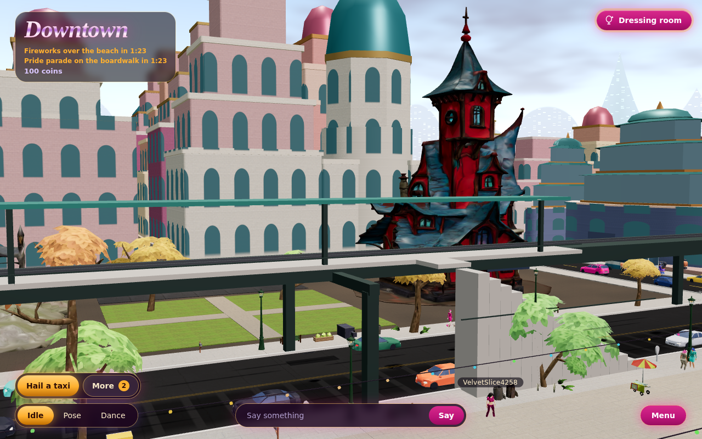
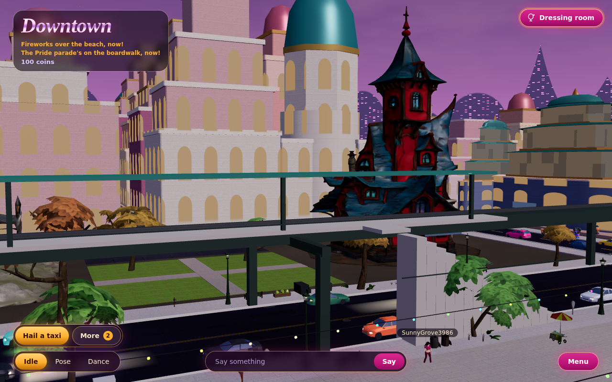
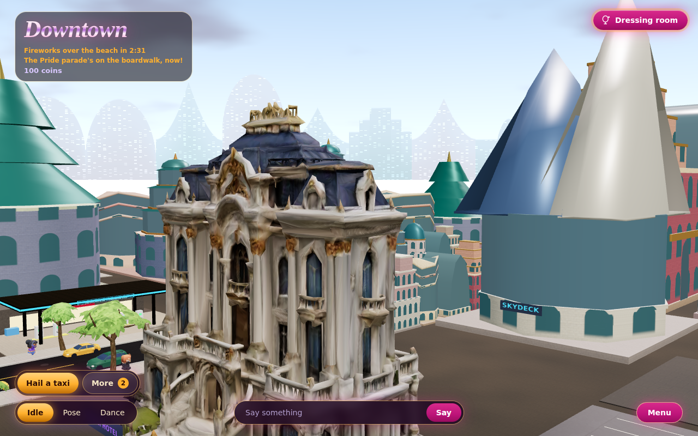
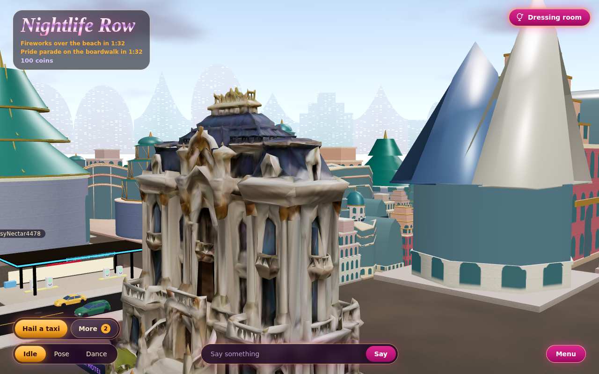
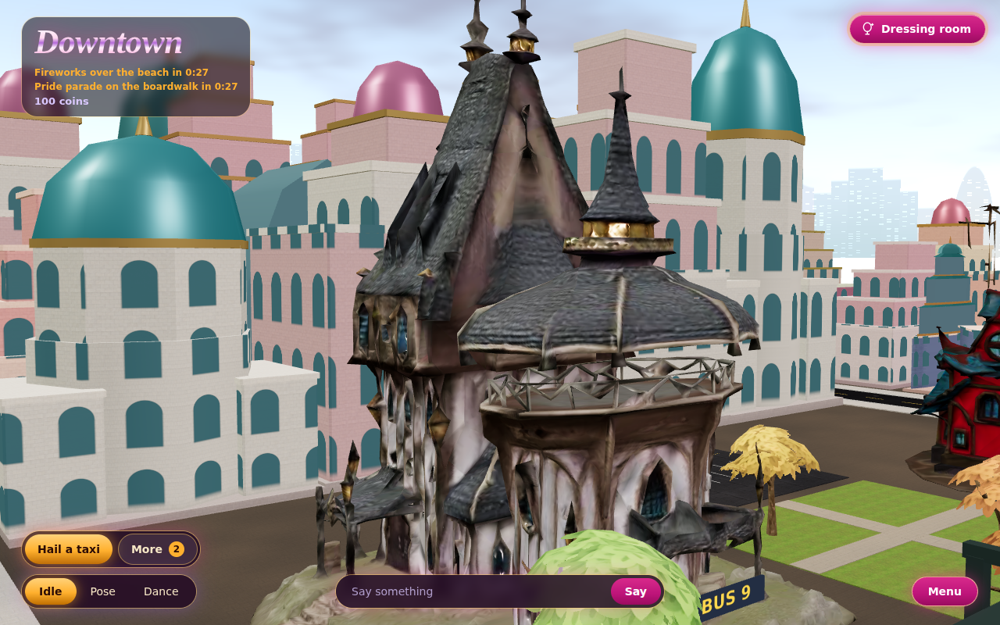
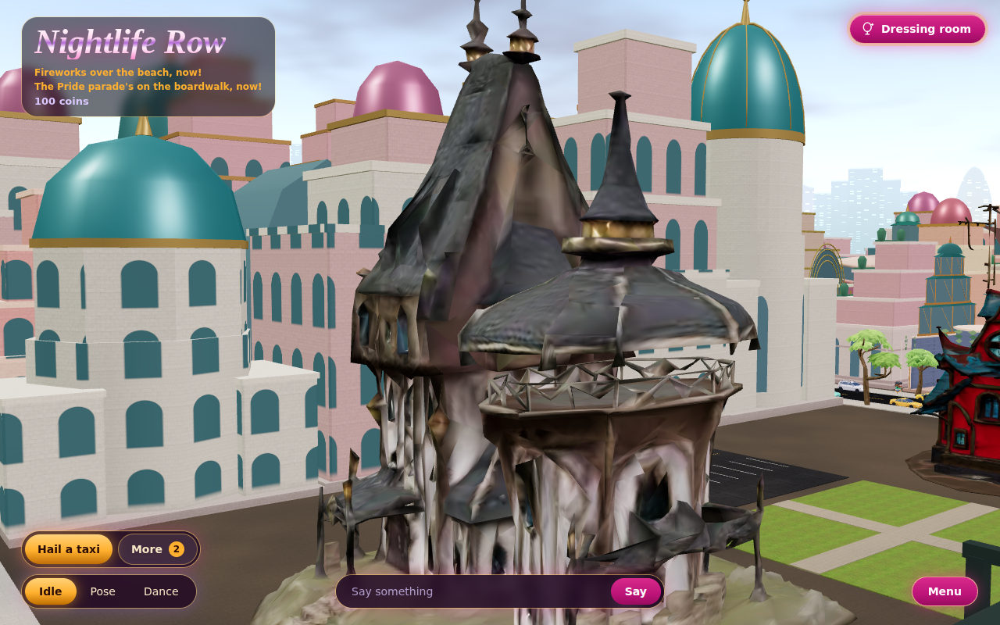

# Dream city: scenery review

The foundation replaces the old repetitive city bodies with twelve authored
architecture families, masonry detail, distant silhouettes and a revised arrival
view. It landed on main in `b32a0477`.

The follow-up adds three unique textured addresses: the arrival avenue's Gothic
manor and crimson clocktower, and Vesper Hotel's Victorian palace. Original PBR
materials remain intact, proportions are preserved, and protected roof faces keep
spires from disappearing in distant models. Existing collision footprints, venue
doors and traffic routes remain compatible.

## Actual low-tier game views

The screenshots below were generated on GitHub from the final landmark runtime
and individually inspected, including the deliberately identical near/far camera
compositions. The player positions differ to force the planner's LOD choice.

| Arrival, day | Arrival, night |
| --- | --- |
|  |  |

| Palace, detailed | Palace, distant |
| --- | --- |
|  |  |

| Manor, detailed | Manor, distant |
| --- | --- |
|  |  |

## Verification

- [Full verification after rebasing onto main](https://github.com/dpologdvinity/daydaze/actions/runs/44065887536): lint, tests, type checking, formatting, build and the performance budget passed.
- [Browser checks](https://github.com/dpologdvinity/daydaze/actions/runs/44065681772): architecture loading across districts, expected landmark readiness, shader/page errors, low-tier render counts and walking through the rebuilt Pulse entrance; arrival and wheel-zoom regressions also passed.
- [Arrival and palace captures](https://github.com/dpologdvinity/daydaze/actions/runs/44065681399) and [distant comparisons](https://github.com/dpologdvinity/daydaze/actions/runs/44065682185) passed.
- Local focused suite: 41 passed, including generated GLB costs, the full sampled low-tier budget grid, roof heights, placement, culling, doorway alignment and credit parity.
- Each of the six exported landmark GLBs validated without errors or warnings. Each detailed landmark is one primitive; each distant landmark uses two, retaining the original upper roof faces. Only three such addresses exist, and their exact costs remain inside the city budget.

Further garden detail, richer roof materials and additional one-off buildings
remain separate enhancements in [#10](https://github.com/dpologdvinity/daydaze/issues/10),
[#12](https://github.com/dpologdvinity/daydaze/issues/12) and
[#11](https://github.com/dpologdvinity/daydaze/issues/11). This review does not claim
that every possible pair of camera positions has been visually compared.

All downloaded source packs and collectors' preparation folders now live in the
main checkout's ignored `local-assets/` directory. Conversion scripts discover it
from Git's common directory, including when run from a linked worktree.
